# Dokumentasi Desain

Dokumen ini merangkum rancangan sistem Simple E-Learning Platform dan alasan di balik keputusan utamanya.

## 1. System design

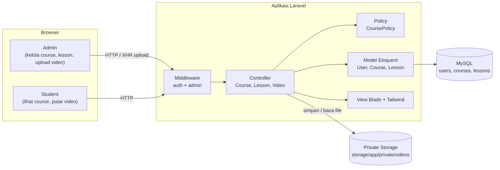

Komponen utama:

| Komponen | Peran |
|---|---|
| Middleware `auth` dan `admin` | Memastikan pengguna login dan, untuk area admin, memiliki role admin |
| `CoursePolicy` | Satu-satunya tempat aturan "siapa boleh melihat course" |
| Controller | Mengatur alur: admin (Course, Lesson, LessonVideo), student (Catalog, LessonPlayer, VideoStream) |
| Model Eloquent | `User`, `Course`, `Lesson` dan relasinya |
| MySQL | Menyimpan data pengguna, course, lesson, dan status video |
| Private storage | Menyimpan file video di luar folder publik |

## 2. ERD

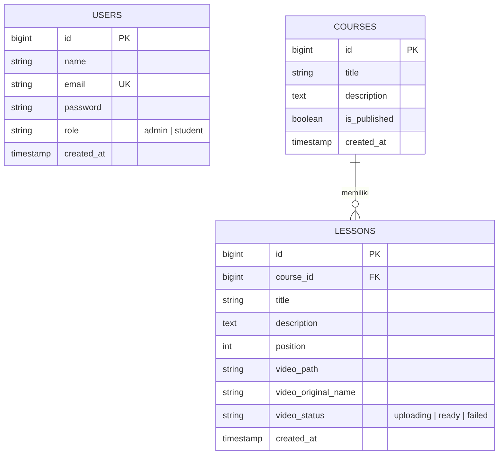

| Tabel | Catatan |
|---|---|
| `users` | Kolom `role` (`admin` atau `student`), default `student` |
| `courses` | `is_published` menentukan apakah student dapat melihatnya |
| `lessons` | `course_id` dengan `ON DELETE CASCADE`; `position` untuk urutan; `video_status` bernilai `uploading`, `ready`, atau `failed` (kosong jika belum ada video) |

Relasi: satu course memiliki banyak lesson (1:N).

## 3. Flowchart upload video

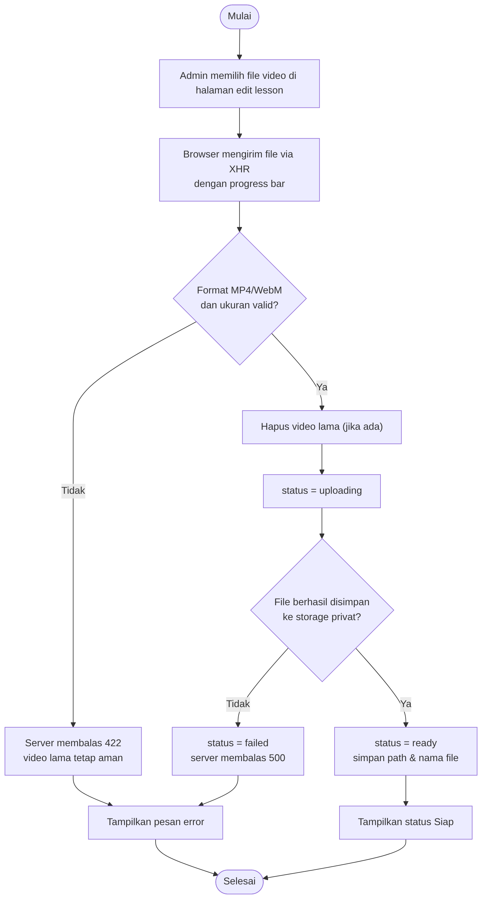

Validasi dilakukan sebelum video lama dihapus, sehingga file baru yang tidak valid tidak menghilangkan video yang sudah ada.

## 4. Sequence diagram

### Pengelolaan course dan lesson (admin)

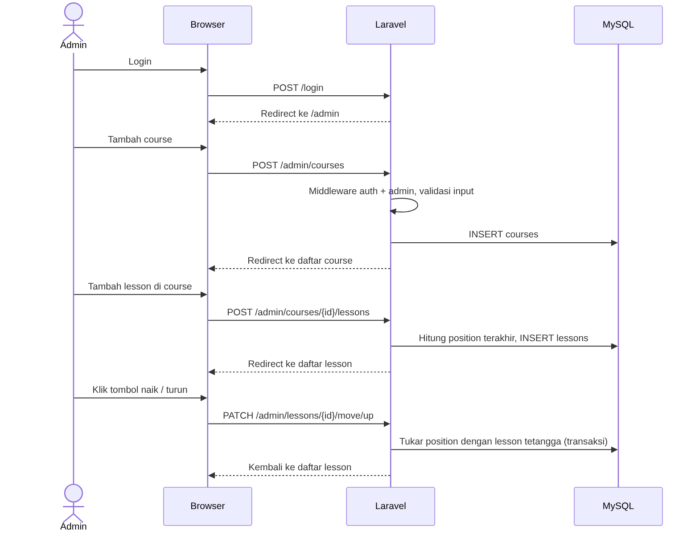

### Pemutaran video (student)

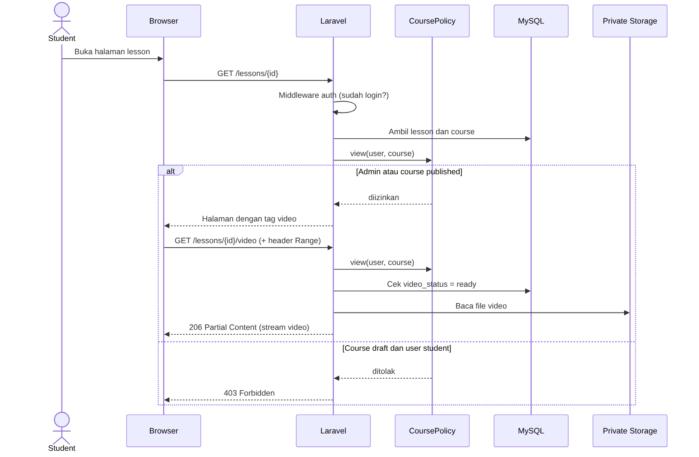

Setiap request video, bukan hanya halaman lesson, melewati pengecekan akses. Dengan begitu video tidak dapat dibuka hanya dengan menebak alamatnya.

## 5. Keputusan UI/UX

- Layout, navigasi, dan komponen form memakai Laravel Breeze dengan Tailwind CSS agar tampilan konsisten di semua halaman.
- Warna utama indigo untuk aksi utama, merah untuk aksi hapus, hijau untuk pesan sukses.
- Tabel pada area admin untuk data yang banyak; kartu (card) pada area student agar lebih ramah dibaca.
- Responsif: grid course menyesuaikan 1, 2, atau 3 kolom; halaman pemutar menjadi satu kolom pada layar kecil.
- Konfirmasi sebelum menghapus, pesan error validasi di bawah kolom yang bersangkutan, dan status/progress upload yang terlihat langsung.

## 6. Wireframe

Wireframe dibuat untuk seluruh halaman yang diimplementasikan. Gaya sengaja dibuat abu-abu polos agar fokus pada tata letak dan alur, bukan warna.

| No | Halaman | Gambar |
|---|---|---|
| 1 | Login dan Register | 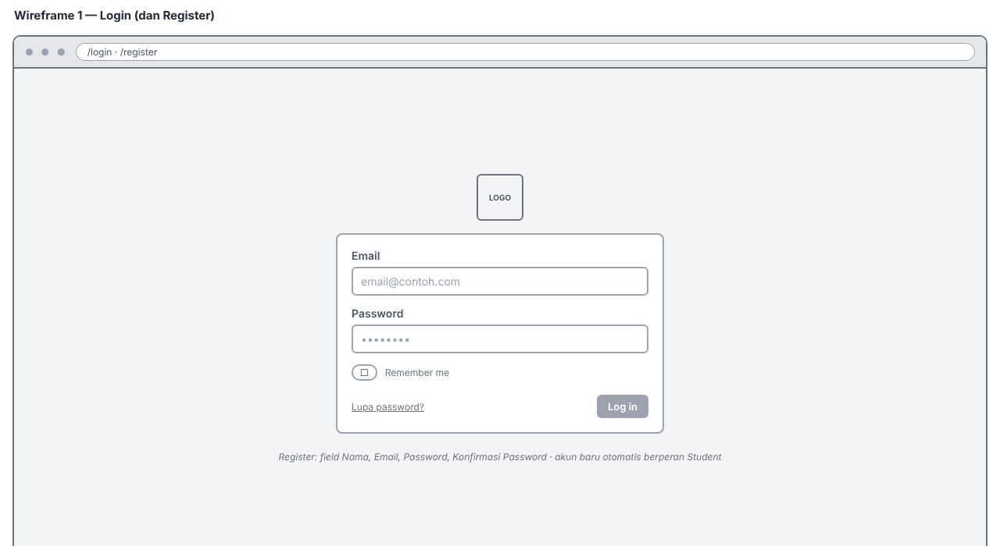 |
| 2 | Admin: daftar course | 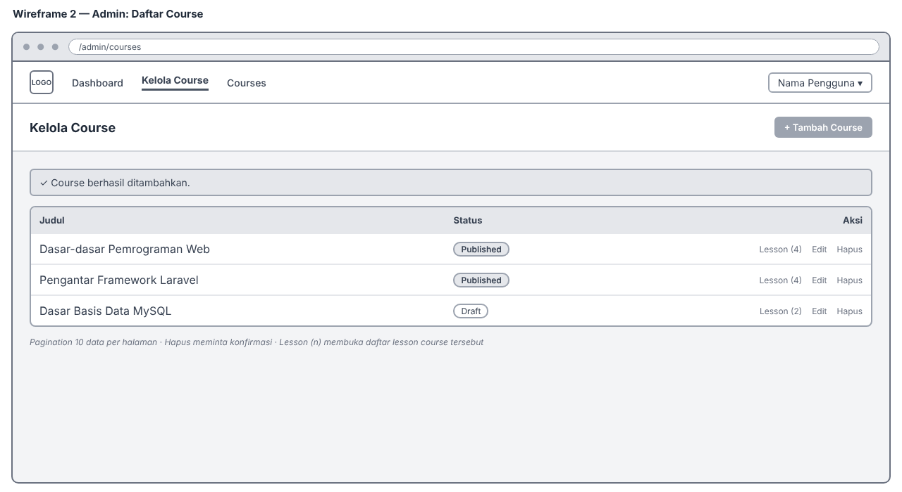 |
| 3 | Admin: tambah/ubah course | 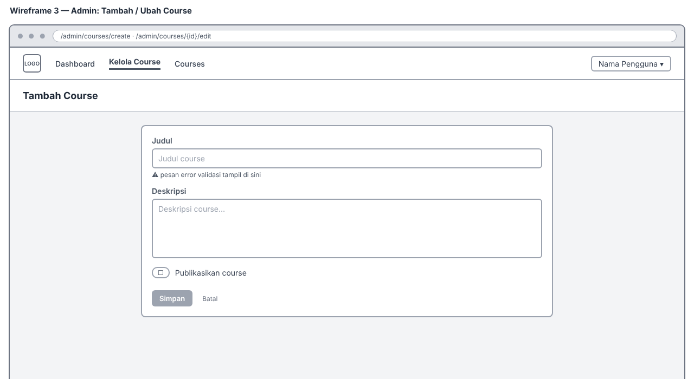 |
| 4 | Admin: daftar lesson | 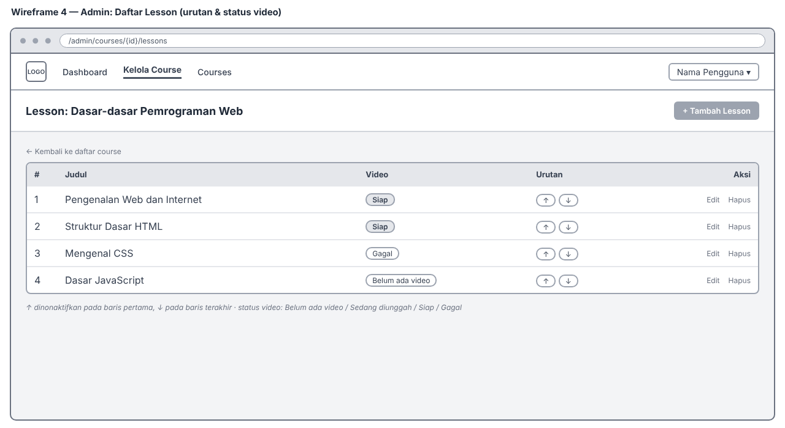 |
| 5 | Admin: ubah lesson dan upload video | 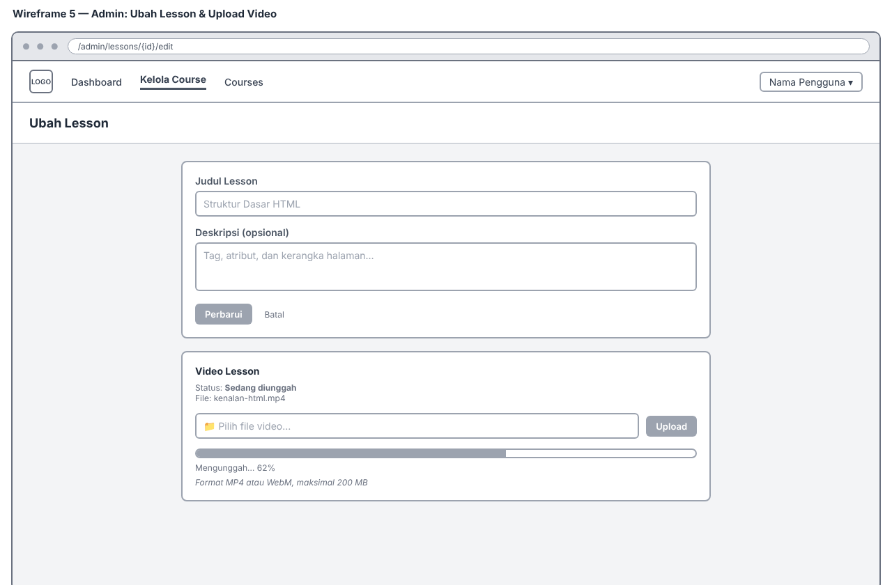 |
| 6 | Student: daftar course | 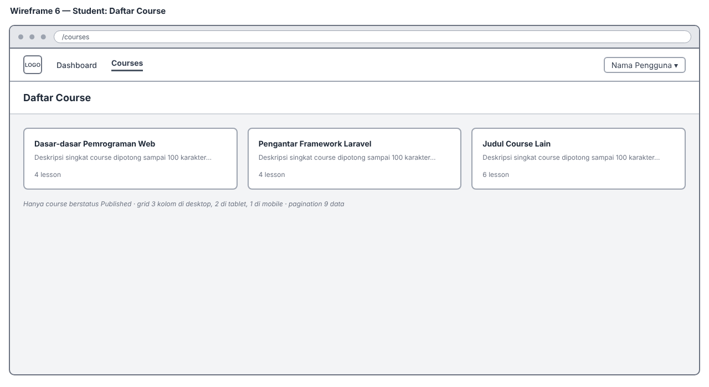 |
| 7 | Student: detail course | 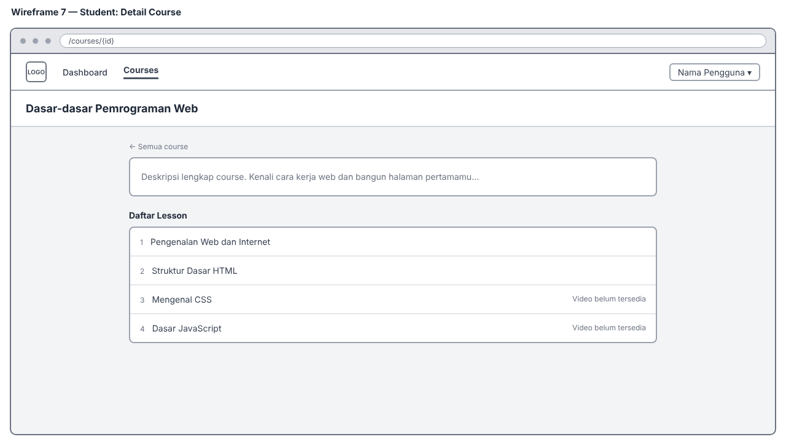 |
| 8 | Student: pemutar video | 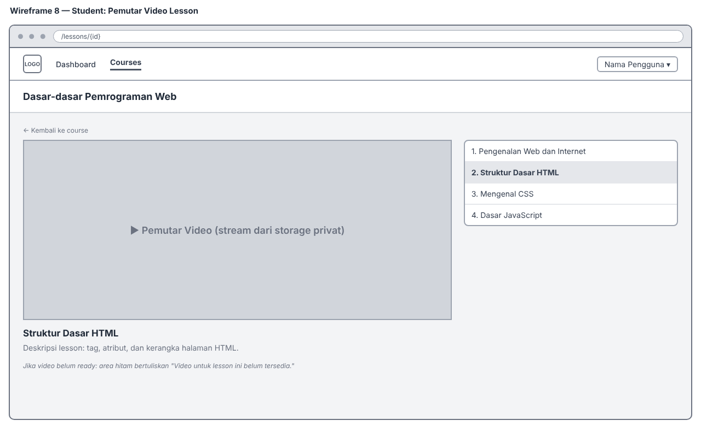 |
| 9 | Mobile: pemutar video | 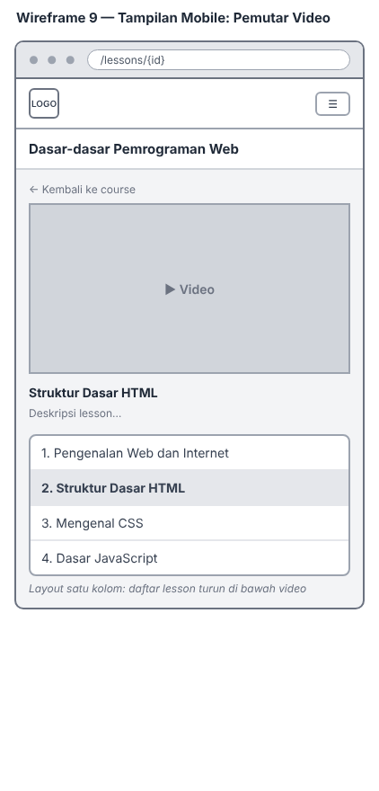 |

Perilaku responsif: pada layar lebar, pemutar video berdampingan dengan daftar lesson (2:1); pada layar kecil, keduanya menjadi satu kolom dengan daftar lesson di bawah video.

Halaman yang diimplementasikan: login, register, daftar/tambah/ubah course, daftar/tambah/ubah lesson (dengan upload video), daftar course student, detail course, dan pemutar lesson.

Sumber diagram dalam format teks (Mermaid) tersedia di folder `diagrams/` (`*.mmd`) dan dapat dirender di https://mermaid.live atau langsung di GitHub.
